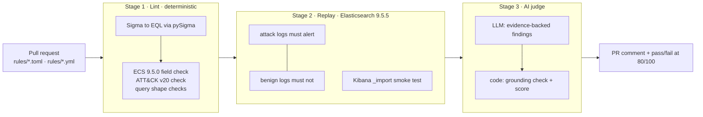

# Elastic Detection-as-Code · AI-as-a-Judge PR gate

Detection rules for Elastic Security, managed like code: every pull request is linted against
ECS, replayed against real attack and benign logs in a real Elasticsearch, deployed to a real
Kibana detection engine, and reviewed by an LLM judge whose findings must be backed by evidence.
Everything runs locally and in GitHub Actions at zero cost: Elastic's free Basic license,
open-source tooling (pySigma, eql, pytest) and an open-weight model served by Ollama.



## Why it is built this way

| Decision | Why |
|---|---|
| Deterministic checks first, LLM last | Anything a script can decide (field exists? `maxspan` set?) is decided for certain and for free. The LLM only handles judgement calls. |
| Replay in **real** Elasticsearch with **ECS mappings** | Only Elasticsearch decides what Elasticsearch matches. With default dynamic mapping, `process.name.keyword` would exist in tests and fail in production: the exact bug to catch. |
| The LLM never sets the score | It returns findings. Code checks each one (verbatim quote? really missing? consistent with ECS?) and turns survivors into points. A persuasive or prompt-injected model can't talk a rule into passing. |
| Leading wildcards judged by **field type** | ECS maps `process.command_line` as `wildcard`, which is built for `*foo*`. The same pattern on `keyword` fields (`file.name`, `process.executable`) is flagged. |
| One test file per rule (`tests/cases/`) | Teams add rules in parallel without merge conflicts; "no tests" fails the gate. |
| KQL rules are rejected | KQL runs only inside Kibana, so it can't be replayed in Elasticsearch. Write EQL or Lucene. |

## Quick start (Windows 11 + Docker Desktop, or Linux)

```powershell
git clone https://github.com/<you>/elastic-detection-as-code
cd elastic-detection-as-code
Copy-Item .env.example .env          # Linux/macOS: cp .env.example .env  -> then set the 3 secrets
python -m venv .venv; .venv\Scripts\Activate.ps1   # Linux: source .venv/bin/activate
pip install -r requirements-dev.txt

docker compose up -d --wait                        # ~2-3 min: ES + Kibana 9.5.5 on 127.0.0.1
python -m dac.validate_rules lint                  # Stage 1 (no cluster needed)
python -m dac.validate_rules replay                # Stage 2
python -m dac.validate_rules bootstrap             # turn on the detection engine
python -m dac.validate_rules deploy                # import rules into Kibana
python -m pytest -q tests/unit
```

Docker Desktop on WSL2: if Elasticsearch exits with `max virtual memory areas vm.max_map_count`,
run `wsl -d docker-desktop -u root sysctl -w vm.max_map_count=262144`.

AI judge locally (needs [Ollama](https://ollama.com)):

```powershell
ollama pull gemma4:e4b
python -m dac.ai_judge_elastic --files rules/elastic/credential_access_lsass_dump_procdump_comsvcs.toml
```

## Repository layout

```
.github/workflows/pr_validation.yml   Stage 1-3 on every PR (all three = required checks)
.github/workflows/deploy.yml          optional CD to a reachable Kibana after merge
docker-compose.yml                    single-node ES + Kibana, security on, localhost only
config/dac.yml                        every tunable: ECS version, policies, judge settings
config/sigma_eql_pipeline.yml         pySigma fixes: drop *.caseless, scope "any where", add ?optional
dac/                                  pipeline code (loader, lint, replay, deploy, judge)
judge/system_prompt.md · rubric.yml · scorecard.schema.json
schemas/                              vendored ECS 9.5.0 fields, ATT&CK v20 catalog, non-ECS allowlist
rules/elastic/*.toml                  native Elastic rules (elastic/detection-rules layout)
rules/sigma/*.yml                     Sigma v2 rules, compiled to EQL in CI
tests/cases/*.yml                     one replay spec per rule
tests/data/atomic_t1003_ecs.json      ECS events modelled on Atomic Red Team T1003.001 tests 1-2 + evasions
tests/data/benign_ecs.json            look-alike benign activity (w3wp dumps, near-miss strings, WER...)
demo/                                 AI-drafted flawed rule, recorded judge answers, rendered PR comment
```

## Adding a rule

1. Write `rules/elastic/<name>.toml` (or `rules/sigma/<name>.yml`) with a UUID `rule_id`.
2. Write `tests/cases/<name>.yml`:
   ```yaml
   rule_id: <same uuid>
   positive:
     - data: tests/data/atomic_t1003_ecs.json
       min_hits: 1
       expect_ids: [atk-001]       # optional: which event.id values must match
   negative:
     - data: tests/data/benign_ecs.json
       max_hits: 0
   ```
3. Run `lint` + `replay` locally, open the PR.

## The AI judge

* **Rubric** (`judge/rubric.yml`): ECS Field Accuracy 35 · EQL/KQL Performance 30 · Evasion & FP
  Hygiene 35. Per finding: critical −20, major −10, minor −4. Any critical caps the total at 79.
  Pass mark 80.
* **Inputs**: the rule as written, the compiled query (Sigma), and `<verified_facts>`: ECS type of
  every field, all lint findings, Stage 2 results. The model is told not to contradict or repeat them.
* **Guardrails in code**: JSON-schema validation with one retry · quotes must exist verbatim ·
  "missing X" claims are checked against the query · ECS claims are checked against the schema ·
  duplicates of lint findings are dropped · discarded findings are listed in the comment ·
  prompt-injection text is a critical lint finding · all rendered text is HTML-escaped.
* **Providers** (`JUDGE_PROVIDER` repo variable): `ollama` (default, open-weight, runs on the
  runner) · `openai_compat` (GitHub Models via `GITHUB_TOKEN` + `models: read`, vLLM, LM Studio) ·
  `replay` (recorded answers, for demos and tests).
* **Human override**: a maintainer can add the `ai-judge-override` label; the comment records it.
* **Cost control**: only changed rules are judged; answers are cached by prompt + model + rule
  content, so re-runs on unchanged rules cost nothing.

## Demo PR

`demo/pr/credential_access_lsass_dump_ai_draft.toml` is a typical one-shot chatbot rule:
hallucinated `process.cmd`, `.keyword` suffix, case-sensitive `==`, a one-day `sequence` without
join keys, an exclusion on `user.name`, and detection that depends on the attacker-chosen dump
file name. Reproduce the PR:

```bash
git switch -c demo/ai-draft
cp demo/pr/credential_access_lsass_dump_ai_draft.toml rules/elastic/
cp demo/pr/tests/credential_access_lsass_dump_ai_draft.yml tests/cases/
git add -A && git commit -m "Add LSASS dump rule (AI draft)" && git push -u origin demo/ai-draft
```

`demo/pr_comment.md` is the comment the judge renders for that PR, judging the AI draft next to
the gold rule. It was produced by the real pipeline (lint, Elasticsearch replay, grounding,
scoring, rendering) with `--provider replay`, which feeds reference judge answers from
`demo/judge_responses/`. Those answers were written for this demo in the judge's JSON format (not
produced by a local model), so the demo is reproducible without a GPU. Two of them are typical LLM
mistakes (a repeat of a lint finding, and a "leading wildcard" complaint about the wildcard-typed
`process.command_line`) so the comment shows the self-check discarding them.

`demo/live_run_gemma4_e2b.md` is the unedited comment from a live run with a small open model
(Gemma 4 E2B, CPU only): every model finding was a repeat or ungrounded and was discarded.

## Tested with

Elasticsearch + Kibana 9.5.5 (Basic license) · ECS 9.5.0 · MITRE ATT&CK v20.0 · pySigma 1.5.1 +
pySigma-backend-elasticsearch 2.1.1 · eql 1.0.1 · Python 3.12 / 3.13 · Ollama 0.40.13.

## Known limits

* Alert generation by the scheduled rules is not part of the PR gate (it needs a schedule wait).
  Checked by hand on 30 Oct 2026: after deploy, indexing `tests/data/*` into
  `logs-endpoint.events.*` data streams made Kibana raise exactly the alerts Stage 2 predicted
  (gold rule: atk-001..005, Sigma rule: atk-001/003/005, nothing on the benign events).
* ES|QL replay rewrites the `FROM` clause to the test index; field checks for ES|QL are basic.
* Small local models add little: in the live E2B run every model finding was discarded, so the
  verdict rested on the deterministic stages. `gemma4:e4b` (default, needs ~10 GB RAM) or a hosted
  OpenAI-compatible model gives real second opinions; CPU inference takes minutes per rule.
